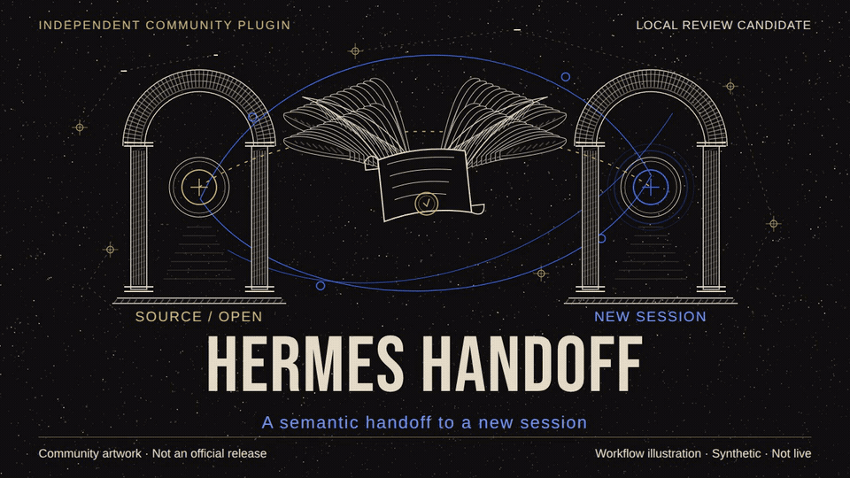

# Hermes Handoff

<p align="center">
  <a href="assets/hermes-handoff-promo.mp4">
    
  </a>
</p>

Hermes Handoff is a native Hermes plugin for preparing a semantic handoff and opening a new CLI or Desktop session in the originating profile. The source stays open; the destination reads the handoff and is instructed to wait for your confirmation before starting work.

Independent community project, not an official Nous Research release. Version 0.3.0 is distributed through [GitHub Releases](https://github.com/yuzushi-dev/hermes-handoff/releases/tag/v0.3.0); catalog listing remains pending. A GitHub release does not imply installation, certification or catalog acceptance. The animated preview and linked 26-second video are synthetic workflow illustrations, not live demonstrations. [Video poster](assets/hermes-handoff-promo.jpg) · [Text alternative](assets/accessibility.md).

## What it does

The plugin creates an immutable handoff from canonical state, binds it to the source session and workspace, and prepares an opening attempt. CLI and Desktop share an opening journal and acknowledgement contract. It does not migrate a session or transfer its complete context.

Choose the destination model/provider (A) independently of an optional summary writer (B). Details: [opening contract](OPENING-CONTRACT.md) and [Desktop contract](DESKTOP-CONTRACT.md).

## Source checkout and local installation boundary

This repository contains 28 native files, including the animated preview, with publication documentation updates. It contains no `package.json`, npm scripts, upstream launchers, telemetry, credentials, transcripts, tests or packaging scripts. Do not run `npm install` or upstream session-handoff setup: that separate project's legacy npm package includes a telemetry postinstall and is not the Hermes plugin.

Download `hermes-handoff-0.3.0.tar.gz` and `MANIFEST.json` from the GitHub release. Check the archive SHA-256 and every member against the manifest before extraction. For an explicitly authorized local installation, inspect the files, then copy only the extracted `hermes-handoff/` directory into `plugins/hermes-handoff` under your explicitly selected Hermes home and enable it through Hermes' plugin consent flow. No catalog installation is offered yet, and no real-profile installation is part of the recorded verification. Historical build/test commands in the retained engineering notes refer to a separate private development checkout; their helpers and evidence are not shipped here.

## Main workflows

| Workflow | Entry point | Behavior |
| --- | --- | --- |
| Prepare a handoff | `hermes-handoff:handoff` skill and `hermes_handoff` tool | Gather evidence, create canonical state and prepare a bound opening attempt |
| Open in a terminal | `handoff-open` CLI command | Open a foreground interactive destination in the source profile |
| Open in Desktop | Handoff sidebar, after enabling | Prepare from the captured source chat and open the frozen attempt |
| Check an attempt | Tool action `opening_status` | Distinguish requested, identified and read states from successful continuation |

### CLI

Load `hermes-handoff:handoff`; `hermes_handoff` must already be enabled by the profile's normal tool policy. In the source session, gather evidence, use `create` with canonical state and a stable `request_id`, then `prepare_open` with the exact ref, workspace and a stable `attempt_id`.

From another terminal using the same `HERMES_HOME`:

```bash
hermes --profile SOURCE_PROFILE handoff-open REF --workspace /absolute/workspace --attempt-id stable-id
```

Replace the placeholders with the prepared values; use the returned `profile`, including `default` for a custom home when returned. A model override requires both `--model MODEL` and `--provider PROVIDER`. The opener requires real stdin/stdout TTYs. `/hh` prints instructions; native `/handoff` is not replaced.

### Desktop

Select an idle source chat on its own active profile gateway, open the Handoff sidebar and enter the absolute workspace. Set A and B if needed. “Prepara handoff dalla chat” requests preparation in that captured source chat; “Apri nuova sessione” opens the frozen attempt. Preparation adds a source turn; opening does not close the source.

The focused chat's profile and connection must match the active backend. Cross-profile gateway and bot workflows are not supported claims. Inspect uncertain preparation or opening before trying again; see the [recovery rules](DESKTOP-CONTRACT.md).

## Compatibility and limits

The historical functional test target is Linux with installed Hermes Agent 0.22.2 (`d923a5eb`). On 2026-10-25, the official stable Hermes Agent v0.22.5 passed admission validation with `hermes plugins validate --install-deps --json`: 16/16 checks passed, `safe: true`, and stderr was empty. v0.22.5 is therefore the conservative admission-tested floor, not proof of the earliest compatible release or full CLI/Desktop certification. Other platforms and versions are not certified. Real Desktop evidence is limited to a synthetic default profile; named-profile SDK stubs do not establish real bot support.

Four runtime-internal imports remain: `coding_selection`, `resolve_toolset`, `_get_platform_tools` and `parse_config_string_list`. No equivalent public plugin API for the complete effective tool policy was found in the tested runtime. The candidate preserves fail-closed preflight rather than widening tool access. Validator warnings and runtime coupling must be disclosed to catalog maintainers; this is not a public-API-only compatibility claim.

## Models and dependencies

A defaults to the latest model/provider observed for the exact source session, never the profile default. With no observed route, both values must be supplied. Temporary endpoint or authentication overrides are not copied; use a stable named provider configured in the same profile.

B defaults to the current chat model preparing state, with no auxiliary writer call. An explicit B uses the host's `ctx.llm.complete` facade. It returns canonical state for inspection; `create` must receive that state unchanged to retain writer attribution.

Explicit B requires user-owned consent for both `plugins.entries.<plugin_id>.llm.allow_model_override` and `plugins.entries.<plugin_id>.llm.allow_provider_override` in profile configuration. Verify the effective key with `hermes plugins list --json`; do not assume it from a renamed directory. Consent is never auto-enabled. Repeated explicit summaries may incur additional inference charges, and host retries or fallback remain host-owned. Authorize external or paid inference before requesting it.

The native flow uses the installed Hermes runtime and configured providers; Desktop uses host-supplied React and SDK. No additional Python dependency or npm installation is declared for this Hermes package.

## Security and data

The CLI child removes inherited `HERMES_YOLO_MODE` and `HERMES_NONINTERACTIVE`, along with source session and worker context flags. It preserves the selected profile and normal host approval policy; it does not override approval settings explicitly chosen in that profile.

Opening passes no broader toolset override, enables no tools and rewrites no profile policy. If normal host selection excludes the handoff tool, preflight refuses. Ad-hoc source-session toolset selections are not transferred.

The optional external writer sends bounded, already-redacted persisted evidence through the configured host provider, not full context or a raw transcript. Early goals, compressed details and in-flight state may be missing. Review the returned state: redaction cannot detect every secret. The route observer stores session/model/provider identifiers, not request payloads. The plugin reads source-session evidence from the profile database and project/Git evidence from the selected workspace; handoffs and opening/writer sidecars remain under the originating profile. Inspect them before sharing.

The terminal opener spawns foreground Hermes without a shell; Desktop requests host-owned session creation and submission. The plugin does not start a persistent background service, collect telemetry or store provider credentials. Provider access and credential management remain host-owned.

The destination is instructed to read and validate the exact handoff, inspect actual project rules and files, summarize discrepancies and a first step, then wait for explicit confirmation. This is a model instruction, not a sandbox or a guarantee of obedience.

Journal states such as `session_identified` and `handoff_read` record progress only. `resume_verified` remains false. A normal child exit does not prove successful continuation. Durable reservations prevent duplicate launches; crashes may require manual recovery. Retries do not guarantee success or exactly-once paid inference.

## Validation

Check the exact native source directory using a new synthetic home, never your active profile (replace `/absolute/hermes-handoff` with your checkout):

```bash
HERMES_HOME=/absolute/isolated-home HERMES_DISABLE_LAZY_INSTALLS=1 hermes plugins doctor /absolute/hermes-handoff --ci
HERMES_HOME=/absolute/isolated-home HERMES_DISABLE_LAZY_INSTALLS=1 hermes plugins validate /absolute/hermes-handoff
HERMES_HOME=/absolute/isolated-home HERMES_DISABLE_LAZY_INSTALLS=1 hermes plugins validate /absolute/hermes-handoff --install-deps
```

Read the diagnostic results, not just exit codes: a missing package-manager runtime can prevent the dependency gate even when the CLI exits zero. Candidate evidence and remaining publication gates are recorded in [candidate readiness](docs/CANDIDATE-0.3.0.md). Synthetic/scripted-provider tests do not certify live model quality or obedience.

Desktop reruns require the user/PID namespace and private process table specified in the [Desktop contract](DESKTOP-CONTRACT.md). Isolated `HOME` alone is unsafe: a historical probe reported reaping processes outside its test. If namespace isolation is unavailable, stop; never launch the user's Desktop as a fallback.

## Attribution and license

Fork of [session-handoff](https://github.com/yuzushi-dev/session-handoff), MIT License, Copyright (c) 2026 Daniele Verì. The native package retains the [license](LICENSE). The [archived upstream README](docs/UPSTREAM-README-session-handoff.md) documents the original Claude Code/Codex product, not installation or capabilities of this Hermes plugin.

The cover and video use original community artwork, not official logos or copied Nous/SEO pixels. The owner approved MIT licensing for the project's original images/video and accepted the graphics/video. Original software copyright/license and third-party licenses/attributions are unchanged. See [media credits and rights](assets/media-credits.md). Editable media sources and their dependency-license notices are retained separately, not shipped in this native source repository. The GitHub release is separate from the pending catalog listing.
